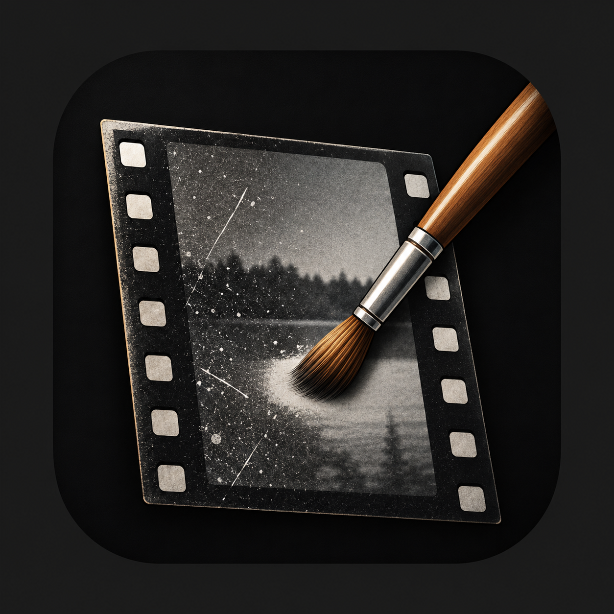

# Film Dust Retouch 



**A lightweight Windows tool for retouching PNG frame sequences.**

FilmDustRetouch is designed for frame-by-frame cleanup of animation, film scans, and other image sequences. It combines a native C++ Windows interface with a Rust image-processing library.

## Tools

### Advanced Remove

Paint over dust, spots, scratches, or other unwanted marks. The tool automatically completes the painted region using nearby image content.

It is based on PhotoCraft's patch-based non-local inpainting implementation, with loop closing, mask expansion, and gradient-domain blending.

### Pencil

A pixel-level drawing tool for precise manual retouching. Adjust the brush size and paint directly onto the image.

### Clone Stamp

Copy pixels from another area of the image to cover unwanted imperfections. Choose a source point and paint over the destination. The tool copies pixels directly, without automatic colour or lighting adaptation.

## Controls

| Action | Control |
|---|---|
| Advanced Remove | `1` |
| Pencil | `2` |
| Clone Stamp | `3` |
| Paint with the active tool | Left mouse button |
| Set source point for Clone Stamp | Right mouse button |
| Previous / next frame | `A` / `D` |
| Previous / next frame | Left / Right arrow |
| Copy from previous frame | Hold `W` or Up arrow |
| Copy from next frame | Hold `S` or Down arrow |
| Undo | `Ctrl+Z` |
| Redo | `Ctrl+Shift+Z` |
| Zoom around cursor | Mouse wheel |
| Change brush size | `Shift` + mouse wheel |
| Pan image | Hold `Space` + drag |
| Open another folder | `Ctrl+O` |
| Toggle fullscreen | `Alt+Enter` |
| Exit fullscreen / clear source point | `Esc` |
| Keyboard shortcuts and localized help | `F1` |
| Donation QR code | `F12` |

Undo and Redo history is maintained separately for each frame. Switching between frames does not erase the editing history.

Modified frames are saved automatically when switching frames or closing the application.

## Requirements

- Windows 10 or later, 64-bit
- Rust stable toolchain: `x86_64-pc-windows-gnu`
- MinGW-w64 x86_64, including `g++`, `gcc`, and `windres`
- Cargo available in `PATH`

The build script automatically adds `C:\mingw64\bin` to `PATH` if that folder exists. Otherwise, make sure your MinGW-w64 `bin` directory is already in `PATH`.

## Build from source

1. Install Rust using [rustup](https://www.rust-lang.org/tools/install).
2. Install the GNU Rust toolchain:

   ```cmd
   rustup toolchain install stable-x86_64-pc-windows-gnu
   rustup default stable-x86_64-pc-windows-gnu
   ```

3. Install MinGW-w64 x86_64 and make sure `g++`, `gcc`, and `windres` are available in Command Prompt.
4. Open the project folder and run `build.bat`.
5. The build script compiles the Rust DLL and the C++ application. The output is placed in `publish`:

   - `publish\FilmDustRetouch.exe`
   - `publish\film_dust_heal.dll`

On the first build, Cargo may download crates from crates.io. Keep the EXE and DLL in the same folder when running the application.

## Usage notes

- Open a folder containing PNG frames.
- Work on copies of important source frames until you are comfortable with the workflow.
- Modified PNG frames are saved automatically; unmodified frames are not rewritten.
- Undo and Redo history is stored separately for each frame and retained when navigating between frames.
- The application uses RAM caching to keep nearby frames readily available during navigation.
- Automatic Remove can take longer on large painted regions.
- Settings are stored in an INI file alongside the application.

## Credits and licensing

FilmDustRetouch's original code is released under the MIT License. See [`LICENSE`](LICENSE).

This project incorporates and adapts code from **PhotoCraft 0.18.0** under its MIT OR Apache-2.0 licensing. The original license texts and notices are preserved in [`third_party/photocraft/`](third_party/photocraft/). See [`THIRD_PARTY_NOTICES.md`](THIRD_PARTY_NOTICES.md) for details.

FilmDustRetouch is an independent project and is not affiliated with, endorsed by, or sponsored by the PhotoCraft project or its contributors.

---

## Support the project

If you find FilmDustRetouch useful, you can support its development via Monobank.

[](https://send.monobank.ua/jar/4uGrBkA4ub)

[Support via Monobank](https://send.monobank.ua/jar/4uGrBkA4ub)

## Author

**Vibeco**
